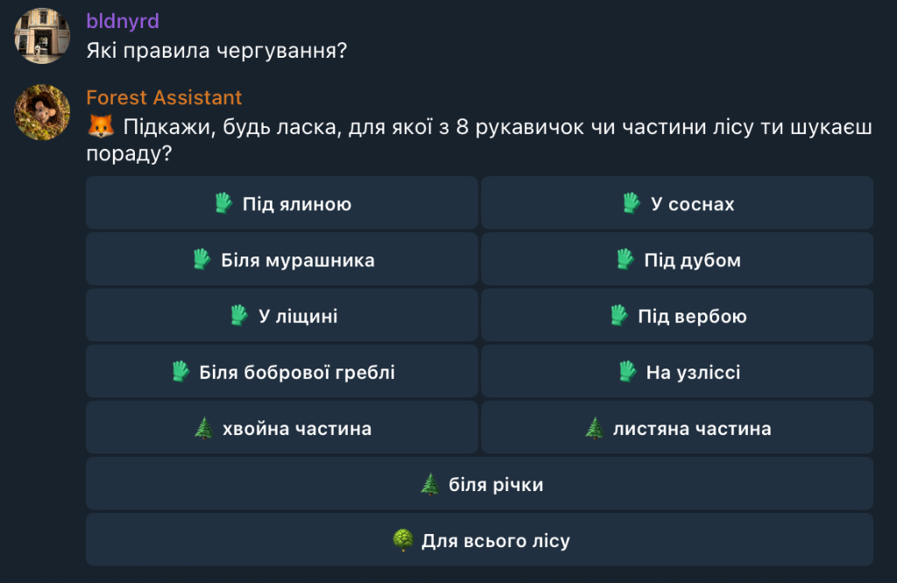
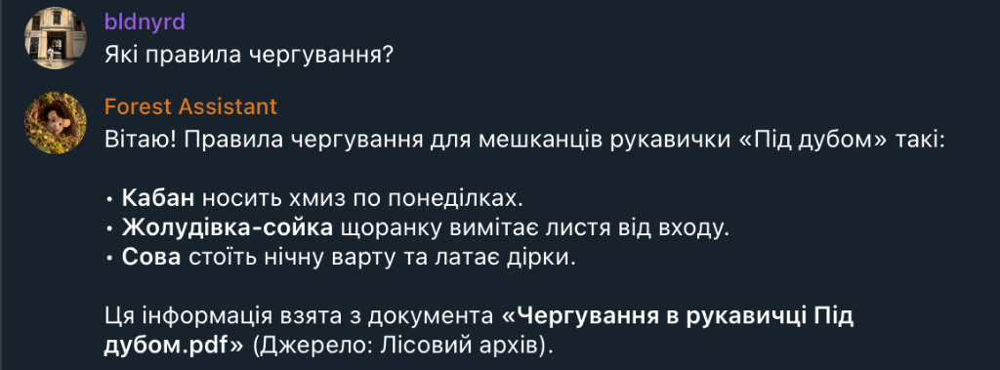
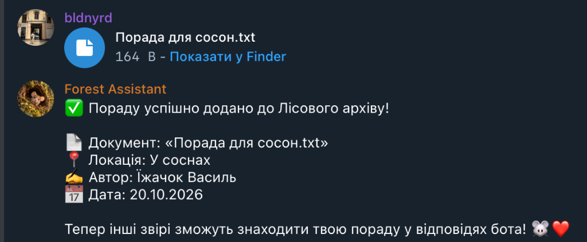
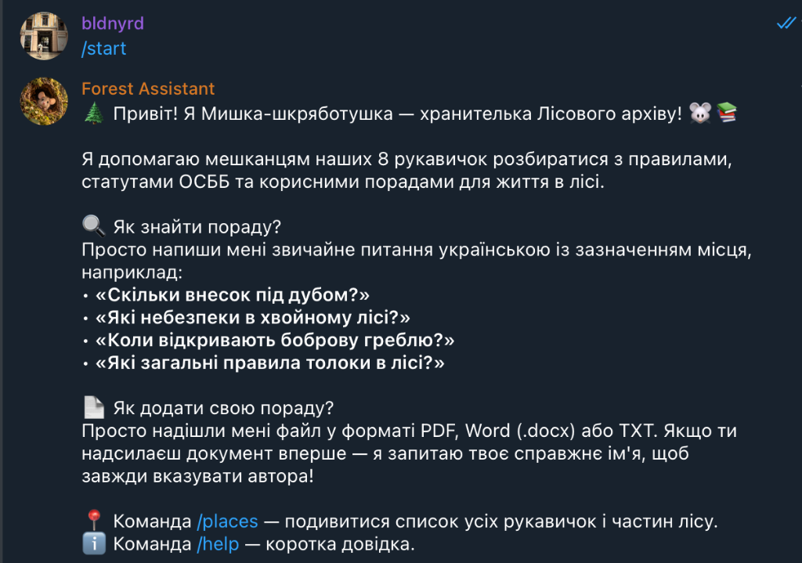

# 🌲 Лісовий асистент («Мишка-шкряботушка»)

[](https://www.python.org/)
[](https://docs.aiogram.dev/)
[](https://groq.com/)
[](https://www.docker.com/)
[](https://sqlite.org/)
[-brightgreen.svg)](https://docs.pytest.org/)

Інтелектуальний Telegram-бот бази знань для лісових звірів (мешканців 8 рукавичок-ОСББ). Бот допомагає знаходити актуальні правила співжиття, чергування та побутові поради за документами, а також дає змогу звірятам поповнювати Лісовий архів власними порадами.

<p align="center">
  
  
</p>

---

## 📋 Бізнес-вимоги та правила Лісової громади

Усі вимоги проєкту були детально зʼясовані та узгоджені в діалозі із замовницею — **Мишкою-шкряботушкою**:

1. **Ієрархія локацій Лісу (8 рукавичок та 3 зони):**
   - **Хвойна частина:** «Під ялиною», «У соснах», «Біля мурашника».
   - **Листяна частина:** «Під дубом», «У ліщині», «Під вербою».
   - **Біля річки:** «Біля бобрової греблі», «Під вербою» (*рукавичка «Під вербою» належить одночасно до двох зон*).
   - **На узліссі:** автономна рукавичка (*не належить до жодної з трьох зон*).
   - **Для всього лісу:** загальні пам’ятки та правила, що діють для всіх мешканців без винятку.

2. **Ієрархія специфічності (Specificity Hierarchy):**
   **Конкретна рукавичка (вага 30)** > **Частина лісу / зона (вага 20)** > **Весь ліс (вага 10)**  
   Якщо для рукавички є локальне правило, воно завжди має вищий пріоритет над зональним чи загальнолісовим.

3. **Версійність та актуальність (Recency Rule):**
   - Новіший варіант того самого документа для того самого місця автоматично замінює старий (`is_active = False`).
   - Будь-який мешканець лісу може оновити документ (наприклад, якщо початковий автор спить узимку).

4. **Правило карантину для неоднозначних документів (Shelving / Anti-Guessing):**
   - Якщо з тексту чи назви архівного документа неможливо однозначно визначити локацію — бот **категорично не вгадує** за деревами чи описами.
   - Такі документи відкладаються в карантин (`is_active = False`) і не використовуються у відповідях, доки мешканці не уточнять їхнє призначення.

5. **Онбординг та обов’язкова атрибуція авторів:**
   - Коли звір уперше надсилає документ, бот запитує його справжнє імʼя (наприклад, *Їжачок Василь*, *Білочка Руда*) і зберігає за `telegram_id`.
   - У кожній відповіді за користувацькими порадами бот обовʼязково вказує: назву документа, **справжнє імʼя автора** та **дату надсилання**.

<p align="center">
  
</p>

6. **Захист від галюцинацій (Groundedness / Anti-Hallucination):**
   - Відповіді формуються виключно на основі знайдених документів.
   - Якщо в документах для вказаної локації немає відповіді, бот чесно повідомляє про це та ввічливо пропонує звірятам поділитися порадою.

7. **Інтерактивне усунення неоднозначностей (Disambiguation):**
   - Якщо користувач не вказав локацію в питанні, бот пропонує зручну інлайн-клавіатуру з вибором з 8 рукавичок чи зон лісу.
   - Якщо звір надсилає документ без чіткої локації — бот перепитує автора кнопками, до якого місця належить порада.

---

## 🏗 Архітектура системи

```
forest_assistant_bot/
├── docs/                    # Скріншоти та демонстраційні матеріали
├── forest_archive/          # 78 початкових документів (PDF, DOCX, TXT)
├── tests/                   # Модульні тести на базі pytest
│   └── test_domain.py       # Тести 8 рукавичок, зон, Unicode NFC та вагів
├── src/
│   ├── bot/                 # Презентаційний шар (Aiogram 3)
│   │   ├── handlers/        # Обробники: base (/start, /help, /places), questions, uploads
│   │   ├── keyboards.py     # Інлайн-клавіатури для 8 рукавичок і зон
│   │   ├── states.py        # FSM стани для онбордингу та уточнення локацій
│   │   └── main.py          # Точка входу, реєстрація роутерів та polling
│   ├── domain/              # Доменна модель лісу
│   │   └── forest_rules.py  # 8 рукавичок, 3 зони, нормалізація NFC, ваги пріоритетів
│   ├── database/            # Шар збереження даних (SQLite + aiosqlite)
│   │   ├── models.py        # Дата-класи DocumentRecord та UserRecord
│   │   └── db.py            # Асинхронний CRUD, версійність, пошук за локаціями
│   ├── services/            # Бізнес-сервіси
│   │   ├── archive_loader.py# Автоматичне завантаження 78 документів при старті
│   │   ├── groq_service.py  # LLM (Groq API, Qwen/Llama) для NLU, JSON-mode та генерації
│   │   ├── search_service.py# Лексичний пошук: BM25 + кастомний re-ranking за вагами специфічності
│   │   ├── parser.py        # Вилучення тексту з PDF, DOCX та TXT
│   │   └── ocr_cache.json   # Вбудований кеш для сканованих PDF (миттєвий старт без Tesseract)
│   └── config.py            # Налаштування pydantic-settings (.env)
├── Dockerfile               # Легковажний образ на python:3.11-slim
├── docker-compose.yml       # Запуск в 1 команду з монтуванням persistent storage
├── pytest.ini               # Конфігурація шляхів для pytest
└── requirements.txt         # Залежності проєкту
```

---

## 🚀 Швидкий старт (Запуск однією командою)

### 1. Клонування репозиторію
```bash
git clone https://github.com/hezhenn/forest_assistant_bot.git
cd forest_assistant_bot
```

### 2. Налаштування змінних оточення
Створіть файл `.env` у корені проєкту (на основі `.env.example`):
```bash
cp .env.example .env
```

Заповніть ваші ключі у `.env`:
```env
TELEGRAM_BOT_TOKEN=ваш_токен_телеграм_бота
GROQ_API_KEY=ваш_ключ_groq_api
GROQ_MODEL=qwen/qwen3.8-27b
DB_PATH=/app/data/forest_bot.db
FOREST_ARCHIVE_PATH=/app/forest_archive
```

### 3. Запуск через Docker Compose
Запустіть весь застосунок однією командою:
```bash
docker compose up --build
```
> При першому запуску бот автоматично створить базу даних SQLite, проіндексує всі 78 документів із «Лісового архіву» і почне приймати повідомлення в Telegram. База даних зберігається у локальній папці `./data` і не зникає при перезапусках контейнера.

---

## 🧪 Тестування бізнес-логіки

Проєкт покритий юніт-тестами на базі `pytest`, які перевіряють правила 8 рукавичок, приналежність до зон, роботу нормалізації Unicode NFC та коректність розподілу вагів специфічності:

```bash
.venv/bin/pytest
```

---

## 💡 Команди бота в Telegram
- `/start` — привітання від Мишки-шкряботушки, огляд можливостей та інструкція.
- `/help` — вичерпна довідка щодо правил пошуку, додавання документів та пріоритетів.
- `/places` — інтерактивна карта всіх 8 рукавичок та 3 частин лісу.

<p align="center">
  
</p>

---

## 🛠 Технологічний стек
- **Python 3.11+**
- **Aiogram 3.17** (FSM, Routers, HTML-форматування)
- **Groq API** (`qwen/qwen3.8-27b` для NLU та генерації відповідей)
- **Rank-BM25** (лексичний пошук із re-ranking за пріоритетами локацій)
- **aiosqlite** (асинхронна база даних SQLite)
- **Pytest** (автоматизоване модульне тестування)
- **Docker & Docker Compose** (контейнеризація та запуск однією командою)
- **PyPDF & python-docx** (парсери документів)
